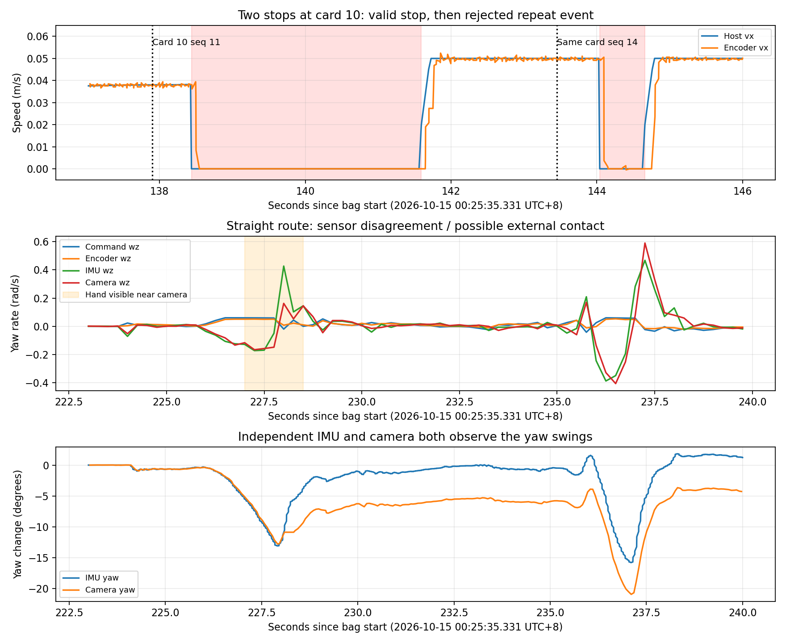

# DM2325 最新录包：RFID 重复停车与直行漂移

分析对象：`20261014T162535.064116Z_a4f169c10d3e`。按 UTC+8 换算，第一条消息为 2026-10-15 00:25:35.330951，最后一条为 00:31:52.842139，时长 377.511 秒。五个压缩分包均已提取相关话题，反序列化无错误。原始录包未修改。

此次运行的是 `visual_navigation/waypoint_navigator`，不是 `contrast_controller`。运行清单中的导航程序、任务管理器程序、导航配置、融合配置哈希与当前文件一致。

## 1. 同一 RFID 点再次停车：证据及原因

这次共有 32 条串口节点 RFID 事件日志，任务管理器接收 27 次候选，其中 11 次合法确认、16 次停车后拒绝。工作流尚未结束时收到的事件会被忽略，工作流结束后的重复事件则会重新启动停车。

10 号卡提供了没有转弯干扰的清晰例子，以下时间均相对录包开始：

| 时间 / 秒 | 事件 |
| --- | --- |
| 137.897 | 同一 UID `56F99389`，卡号 10，事件序号 11 |
| 138.438 | RFID hold，导航指令归零 |
| 138.938 | 确认卡有效，进入坐标校正和播报 |
| 140.838 | 授权 checkpoint，解除 RFID hold |
| 141.164 | 原路线完成，随后规划新路线 |
| 141.593 | 恢复 FOLLOWING，指令约 0.05 m/s，编码器约 0.049 m/s |
| 143.445 | 同一 UID、同一张卡再次上报，事件序号已经变为 14 |
| 144.039 | 再次 RFID hold，指令归零，轮速也降至近零 |
| 144.638 | 此时才以 `outside_expected_route_window` 拒绝重复卡 |
| 144.659 | 恢复 FOLLOWING |

两次零指令区间为 138.438–141.592 秒、144.039–144.659 秒；中间车辆有实际编码器前进反馈。因此这不是连续停车状态的重复日志。

数据链路：

1. 下位机 `modules/rfid/rfid_reader.c:175` 在一次寻卡失败或超时后直接清除 CARD_PRESENT；随后同 UID 重现时 `card_sequence` 增加。没有连续离卡确认。
2. 上位机 `src/cup_car_serial/include/cup_car_serial/rfid_event_deduplicator.hpp:13` 只去重“序号相同且 UID 相同”。序号变化，即使卡相同，也发布新的卡号事件。
3. 任务管理器 `src/navigation_mission_manager/src/rfid.cpp:163` 不先判断是不是刚处理完的卡，而是安排 0.5 秒后停车。
4. 卡号、路线窗口及 3 秒 cooldown 均在停车稳定后校验。已有 cooldown 按 waypoint index 记录，并不构成停车之前的同卡过滤。新路线会清除已确认 waypoint 集合。

原始 RFID 帧在第一次有效读卡之后反复出现无卡状态；之后同 UID 依次被识别为序号 12、13、14，直到序号 14 成功读出卡号，产生第二次候选。这证明“离卡/重现”的信号确实发生了，但不能据此认定车离开并重新进入了一个独立巡逻点。

修正方向：保留首次读卡的停车校验，在进入停车工作流前加入“同 UID、同一次经过”的过滤，并以持续离卡或离开该点一定距离重新允许触发；同时下位机对短暂寻卡失败增加离卡确认。需要保留日后合法重访同一卡的能力。仅增加播报后的停留时间无法解决这个链路问题。

## 2. 直行左右慢飘：已证实的现象与归因边界

### 规划路径是直线；部分段是在慢慢回到规划线

例如 58.5–78 秒路线从 (0.2,-0.5) 到 (1.2,-0.5)，是水平直线。融合位置在出弯后从约 (0.261,-0.420) 逐渐走到 (1.153,-0.498)，控制器因此持续调整航向。这里的坐标是定位估计，不能把其中的横向差值直接叫做车与真实场地线的物理距离。

当前横向控制使用 Stanley 路径误差、PID 和 IMU 角速度阻尼。关键实参为：cross_track_gain=1.0，stanley_softening_speed=0.25，kp=1.2，ki=0.08，yaw_rate_damping=0.45。要求停车的路段还限制 |w| <= 1.2 |v|，在 v=0.05 m/s 时只允许约 0.06 rad/s；扫描 v=0.035 时约 0.042 rad/s。虽然 min_path_angular_speed=0.12，最终仍会被这个限制压下来。因此出弯后偏离路径时，会出现较慢的回线动作。

### 存在车身回摆，但本次确认有人工扶车，不能据此判定底盘响应异常

223.9 秒启动的是 (4.2,-0.5) 到 (4.2,0.5) 的竖直直线。在某些小修正期间，指令和编码器航向与实际车身航向不一致：

| 区间 / 秒 | 指令平均 w | 编码器平均 w | IMU 平均 w | 相机平均 w |
| --- | ---: | ---: | ---: | ---: |
| 226–228 | +0.0520 | +0.0421 | -0.1034 | -0.1104 |
| 236–237 | +0.0510 | +0.0364 | -0.2938 | -0.2782 |

单位均为 rad/s。正为左转，负为右转。236–237 秒下位机确实收到了正 w，左右轮目标约 0.0471 / 0.0519 m/s，电机反馈约 0.0489 / 0.0523 m/s；编码器也给出正转向。但 IMU 和相机均观察到负转向，随后车身快速反向回摆。

IMU 与相机是不同来源，因此不是只有融合定位曲线在变化。用户已确认本次途中扶过车或调整过车头，并进一步说明是先偏离严重，再把车头推回赛道；人工干预不能解释最初的偏离。相机在约 227 秒开始拍到手靠近镜头，228 秒存在遮挡和画面晃动。外力调整车头时，编码器仍主要记录驱动轮转动，而 IMU 和相机记录车身实际转动，二者方向可以不同；导航还会根据新的航向和位置继续纠偏。因而这些不一致不能作为电机映射、轮距或底盘自主响应错误的证据。人工接触的完整时间范围尚未确定，不能把所有回摆都断言为扶车，也不能把上述区间都当成无外力运行。其他时段正负方向是正常的。

### 当前下位机航向保持基本没有连续启用

`application/cmd/robot_cmd.c:250` 只在收到的 w 恰好为零时设置 straight_requested，航向保持和轮同步仅在该条件下启用。上位机串口把 w 格式化为三位小数，因此少数极小指令会被量化为零，短暂启用保持；下一条非零修正又退出，参考航向也随重新启用而重建。

146–161 秒直行时，150 个 CTL 样本只有 5 个收到零 w；608 个 HLD 样本只有 16 个 active。225–240 秒为 600 个 HLD 中 10 个 active。不能把本次直线运行视为“下位机一直用 IMU 锁着车头”，也没有证据支持两个持续工作的航向环互相对抗。

### 并非每段直行都在明显摆动

146–161 秒指令速度约 0.05 m/s，IMU 航向仅改变约 -0.55°，相机航向约 -0.51°，融合横向位置变化约 1.2 mm。后一项仍然只是定位估计。这个对照说明不能用一个固定轮距偏差解释全部时段；轮距缩放不能把同向指令在部分时段变成反向车身响应。

### 建议处理顺序

RFID 同次经过的重复停车结论不受扶车确认影响，应先修重复触发。对于直行，用户补充确认人工干预发生在严重偏离之后，不能用扶车否定自主运行的问题。此次能确认算法看到了航向误差并持续纠偏，但横向定位误差仍小，纠偏达到整段转向限幅后仍继续前进。首先应检查真实赛道与定位地图的一致性，以及整段限幅和偏离后减速/停车的逻辑；另用未受外力的连续片段核对小幅正负 w 与 IMU/相机响应方向。此次数据不支持据此改变轮距或左右电机映射。明确导航转向与下位机直行保持的控制权，不能直接把“严格零”放宽成较大角速度死区，否则可能重新出现下位机抵消上位机纠偏。

### 用户补充后的复核：算法发现了什么，为什么未及时纠正

用户明确说明：车先偏得严重，才把车头向赛道推回。因此之前仅强调人工干预而没有解释干预前的偏离是不完整的。以下将算法输入、输出与人工干预的影响分别说明。

223.96 秒开始跟踪的目标线为 x=4.2、航向 90°。相机约 227 秒开始可见手，但手进入画面不能精确代表接触开始时间。按照实际融合输入重算，算法看到的是：

| 相对时间 / 秒 | 航向偏差 / 度 | 定位估计横向偏差绝对值 / mm | 实际 w 指令 / rad/s | 实际 v 指令 / m/s |
| --- | ---: | ---: | ---: | ---: |
| 226.6 | 1.89 | 1.78 | +0.0600 | 0.050 |
| 227.2 | 6.00 | 0.66 | +0.0597 | 约 0.050 |
| 227.5 | 8.76 | 0.59 | +0.0593 | 约 0.049 |
| 227.8 | 11.64 | 1.65 | +0.0587 | 约 0.049 |

这些横向数值仅是控制器定位输入，不能当作真实车辆到场地中线的测量。航向偏差增加时，控制器持续发送正 w，串口 CTL 也确认收到了约 +0.059～+0.060，左右轮目标产生相应差速。因此算法没有完全失去输入，也没有不发指令。

局部控制器没有接收真实赛道边线/车道中心线的观测，只比较 `/odometry/fused` 与地图 waypoint 线。相机在此次链路中参与 SLAM 定位，并不直接反馈“车轮离赛道边沿多远”。RFID 校正只提供 XY，不测定赛道方向；视觉坐标还存在重锚与平滑。因此定位误差接近零，不代表物理车辆肯定处于赛道中间。需要核对地图对齐、定位横向估计与实际赛道的关系。

其次，`RunPath()` 只要当前 waypoint 要求停车，就在整段调用 `StopRequiredPathAngularSpeed()`，没有限定为临近终点的刹车区。此处 RFID 是路线终点，满足停车条件，即使距终点仍有约 0.84 m，纠偏仍受 `pre_turn_path_angular_ratio=1.2` 限制：v=0.05 时 |w| 仅允许 0.06 rad/s，即约 3.44°/s，对应约 0.83 m 的运动转弯半径。`min_path_angular_speed=0.12` 在这个限制之前执行，不能突破最后的 0.06 限幅。

以 227.5 秒的输入重算 PID 的 P 项和 IMU 角速度阻尼，未计积分项就约 +0.256 rad/s，而实际输出只有 +0.0593。这说明航向偏差被发现后，输出纠偏明显受限。该上限本身不能证明反向车身响应的原因，但能解释为何增大偏差时指令没有进一步增强。

横向降速从定位横向误差 15 mm 才开始，40 mm 时也只是降至 0.04 m/s。上表的估计横向误差远低于 15 mm，航向的余弦降速在 11.64°时只减少约 2%。导航在该区间持续 FOLLOWING，没有进入停车恢复。`pathError>0.70 rad` 才触发路口退回，不能及时保护这里约 0.21 rad 的偏差。因此“发现了航向偏差”并不等于“足以纠回真实赛道”。

需要优先检查：地图定位与物理赛道是否一致；将避免刹车末端原地旋转的限制合理限定到相应阶段；在可确认的持续偏离或纠偏无效时减少前进速度并触发停止/恢复。人工推回期间的传感器反向不能直接证明映射错误，但不能据此否定推回前已存在的问题。

本次未修改配置或源码。

## 图表

五段提取数据：`/media/hjh/E/dm2325_analysis/20261014T162535.064116Z_a4f169c10d3e/extracted.json`。相机抽帧：同目录 `straight_frames.jpg`。
